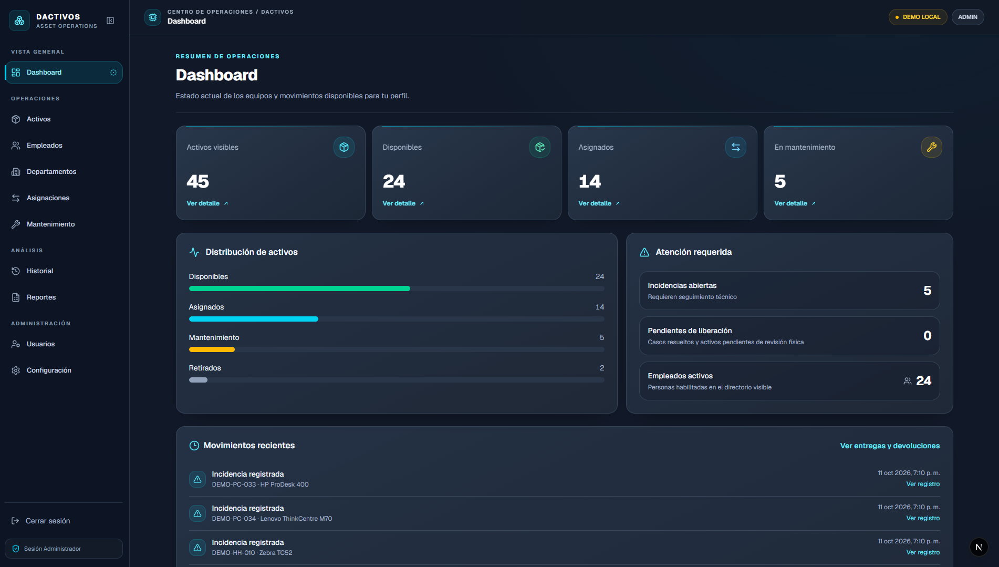
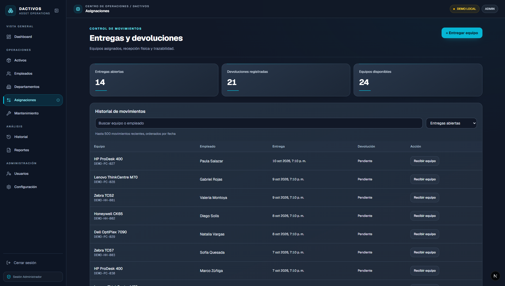
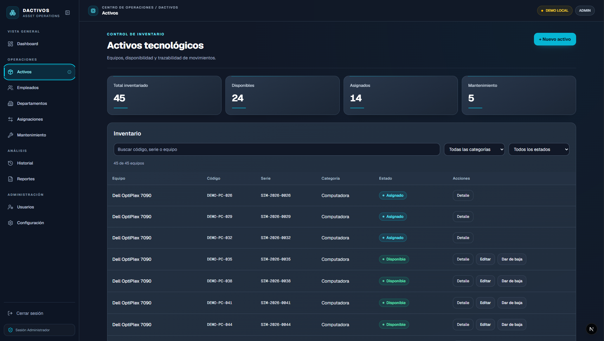
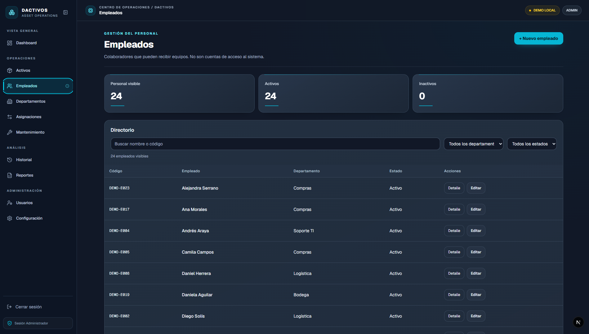
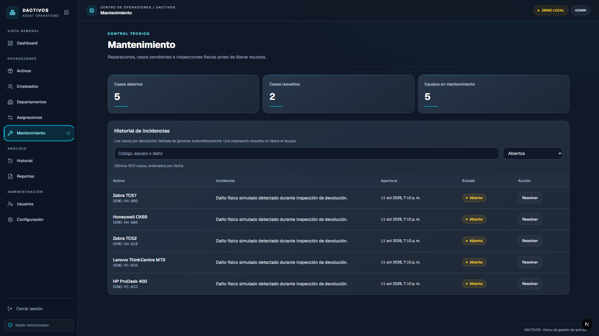

# DACTIVOS

Asset tracking for the technology equipment of an operations center: which handhelds and computers exist, who has each one, how they come back, and what happens when they come back damaged.



## Project overview

Operations staff use handheld scanners and computers that are handed out, returned, repaired and eventually retired. Without a system, knowing which device each person has, whether it came back in good condition and whether a repaired device was really checked before going back into circulation depends on spreadsheets and memory.

DACTIVOS keeps that cycle in one place:

- Each asset is registered once and is always in one known status: available, assigned, in maintenance or retired.
- Each delivery records who received what, and each return records the physical condition.
- A damaged return opens a maintenance case on its own; the device only goes back into circulation after the repair is resolved **and** someone checks it physically.
- Every movement, account change and retirement is written to an audit history by the database itself.

It is an internal web app with two roles, **Security** (operators who hand out and receive equipment) and **Administrator**. There is no public sign-up.

The user interface is in Spanish. Terms used in this README and in the screens:

| Term                     | Meaning                                                         |
| ------------------------ | --------------------------------------------------------------- |
| Activos                  | Assets: handhelds (`HANDHELD`) and computers (`COMPUTER`)       |
| Empleados, Departamentos | Employees who receive assets, and their departments             |
| Asignaciones             | Deliveries and returns                                          |
| Mantenimiento            | Maintenance cases and the physical check that releases a device |
| Historial                | Audit history                                                   |
| Reportes                 | CSV reports (administrators only)                               |
| Usuarios                 | Accounts: invitations, roles and status (administrators only)   |
| Dar de baja / Reactivar  | Retire / reactivate an asset                                    |

## Screenshots

|                                                                                |                                                                             |
| ------------------------------------------------------------------------------ | --------------------------------------------------------------------------- |
|           |                    |
| **Asignaciones** — open deliveries, returns and the "receive equipment" action | **Activos** — inventory by status and category, with search and filters     |
|                  |            |
| **Empleados** — people who receive assets, by department                       | **Mantenimiento** — cases opened by damaged returns, waiting for resolution |

The screenshots come from a local installation with fictitious data.

## Features

- **Inventory** of handhelds and computers with internal code, serial number and status; search and filters; an asset is created as available and its status only changes through the operations below.
- **Deliveries** by typing or scanning the internal code or serial: the server resolves the reference and refuses an unknown or ambiguous one. An asset has one open delivery at most, and an employee one per category, even when several operators act at once.
- **Returns with physical inspection:** good or damaged. A damaged return moves the asset to maintenance and opens a case automatically.
- **Maintenance:** resolving a case does not release the device; a separate physical check does, and each check releases it only once.
- **Retirement and reactivation** by administrators, with a mandatory reason and an immutable log.
- **History** of deliveries, maintenance, catalog changes, account changes and retirements, filtered by role.
- **CSV reports** of assets, employees, deliveries and maintenance, ready for Excel and protected against spreadsheet formulas.
- **Accounts:** administrators invite people by email; invited accounts start inactive until an administrator enables them. Terminal commands cover the first administrator and recovery.
- **Dashboard** with counts by status, open cases, devices waiting for release and recent movements; a value that could not be read is shown as unavailable, never as zero.

## Tech stack

| Layer      | Technology                                                              | Why                                                                                     |
| ---------- | ----------------------------------------------------------------------- | --------------------------------------------------------------------------------------- |
| Language   | Strict TypeScript, Node.js ≥ 22.18                                      | One language for the app, scripts and tests                                             |
| Web        | Next.js 16 (App Router, Server Actions, Partial Prerendering), React 19 | Server-rendered screens and forms without a separate API layer                          |
| UI         | Tailwind CSS 4, Base UI primitives, lucide-react                        | A small set of accessible primitives and a custom dark theme                            |
| Validation | Zod 4                                                                   | Typed validation of every form on the server                                            |
| Data       | Supabase: PostgreSQL 17, Auth, PostgREST, an Edge Function              | Business rules as database functions and constraints; managed authentication            |
| Local      | Supabase CLI with Docker                                                | The same database, Auth and email inbox on any machine and in CI                        |
| Testing    | `node:test`                                                             | Unit tests, source checks and integration tests against a real database                 |
| Delivery   | GitHub Actions, Dependabot                                              | Lint, types, tests, build, integration, dependency audit and secret scanning per change |

## Architecture

```text
Browser ──► Next.js server (pages, server actions, CSV route)
              │  requirePermission(): user from Supabase Auth + role from the database
              ▼
            Supabase ── Auth ── PostgREST ── PostgreSQL (closed tables, role-checking functions, triggers)
                     └─ Edge Function dactivos-invite (invitations; the only place with the service key)
```

- **The database is the authorization boundary.** App users cannot read or write any table; every operation is a PostgreSQL function that checks the caller's role first and applies the rules in one transaction. The web app checks permissions too, but never alone ([ADR 0002](docs/decisions/0002-authorization-in-the-database.md)).
- **The browser never talks to Supabase.** Pages and actions run on the Next.js server with the user's session cookie; no privileged key exists in the web app.
- **Rules as constraints:** partial unique indexes, row locks and triggers keep the inventory consistent under concurrent requests.

Details: [`docs/architecture.md`](docs/architecture.md). Requirements: [`docs/requirements.md`](docs/requirements.md). Each significant decision has an ADR in [`docs/decisions/`](docs/decisions/README.md), and [`CHANGELOG.md`](CHANGELOG.md) summarizes how the project evolved.

## Project structure

```text
src/
  app/              routes: (auth) sign-in and invitations, (dashboard) private screens,
                    actions/ server actions, api/reportes CSV export
  components/       one board per screen, layout and shared operation components
  lib/              auth (permissions, password rule, sign-in limits), supabase clients,
                    RPC parsers and loaders per domain, dashboard summary, CSV
  proxy.ts          session refresh on every request
supabase/
  migrations/       the database schema: tables, constraints, functions, triggers, grants
  functions/        dactivos-invite Edge Function
  templates/        invitation email
  config.toml       local Supabase settings
scripts/            env:local, demo:setup, users and create-admin
tests/              unit/, source/ and integration/
docs/               requirements, architecture, ADRs, security, testing, screenshots
.github/            CI workflow and Dependabot
```

## Prerequisites

- **Node.js ≥ 22.18** and **npm** (the scripts are TypeScript run directly by Node)
- **Docker**, running (the Supabase CLI starts the local database, Auth and email inbox in containers)

## Getting started

```bash
git clone https://github.com/Aaron23486/dactivos.git
cd dactivos
npm ci                  # exact versions from package-lock.json, including the Supabase CLI
npm run db:up           # local Supabase in Docker; applies the migrations (the first run downloads images)
npm run env:local       # writes .env.local with the local URL and public key
npm run demo:setup      # demo accounts (one per role) and fictitious data
npm run dev             # http://localhost:3000
```

Then sign in with one of the accounts printed by `demo:setup` (see [Authentication and demo access](#authentication-and-demo-access)).

## Environment configuration

The web app needs only two **public** values, documented in [`.env.example`](.env.example). `npm run env:local` writes them from the running local Supabase.

| Variable                               | Purpose                                             |
| -------------------------------------- | --------------------------------------------------- |
| `NEXT_PUBLIC_SUPABASE_URL`             | Supabase API URL (`http://127.0.0.1:54321` locally) |
| `NEXT_PUBLIC_SUPABASE_PUBLISHABLE_KEY` | Supabase publishable (public) key                   |

No secret goes into `.env.local`: every `NEXT_PUBLIC_` value reaches the browser bundle. The terminal commands read the local secret key from the Supabase CLI when they run. For a hosted project they accept `SUPABASE_URL`, `SUPABASE_PUBLISHABLE_KEY` and `SUPABASE_SECRET_KEY` from the terminal's environment only. Never commit `.env.local`.

## Database setup

```text
departments 1──N employees 1──N asset_assignments N──1 assets N──1 asset_categories
asset_assignments 1──1 asset_return_inspections 1──0..1 asset_maintenance_cases
asset_maintenance_cases 1──0..1 asset_release_validations
auth.users 1──0..1 profiles (role, is_active)
```

Rules enforced by the database, not only by the code:

- **An asset has one open delivery at most, and an employee one per category:** partial unique indexes `WHERE returned_at IS NULL`.
- Status changes only through deliveries, returns, releases and retirements; triggers reject anything else.
- A damaged return opens exactly one maintenance case; a physical check releases the asset once.
- Codes and serial numbers are unique regardless of case.
- Audit rows are written in the same transaction as the change; the retirement log cannot be modified.

```bash
npm run db:up       # start the local Supabase and apply pending migrations
npm run db:reset    # recreate the local database from the migrations (deletes local data)
npm run db:status   # URLs of the API, Studio (database browser) and Mailpit (email inbox)
npm run db:down     # stop the containers
```

The schema is in [`supabase/migrations/`](supabase/migrations). Full details in [`docs/architecture.md`](docs/architecture.md#4-data-model).

## Authentication and demo access

There are two roles, **Security** and **Administrator**, with no public sign-up. Reports, the full history, accounts, configuration and retirement are for administrators only.

**Demo access (local):**

```bash
npm run demo:setup
```

It creates `admin@demo.dactivos.test` (Administrator) and `seguridad@demo.dactivos.test` (Security) with generated passwords that are **printed only once**, plus 5 departments, 12 employees and 20 assets with deliveries, returns, a maintenance case and a retirement, all created through the app's own functions so the history is real. Running it again issues new passwords and never duplicates the data. It refuses to run against anything but the local Supabase ([ADR 0008](docs/decisions/0008-demo-access.md)).

**Inviting accounts:** an administrator invites people from **Usuarios**. Locally, invitation emails arrive in Mailpit (`npm run db:status` shows its URL). The person accepts, sets a password, and the account stays inactive until an administrator enables it.

**Terminal commands** for the first administrator and for recovery ([ADR 0007](docs/decisions/0007-local-database-and-terminal-accounts.md)):

```bash
npm run create-admin                            # first administrator (asks for email and password)
npm run users -- create                         # a Security account
npm run users -- list
npm run users -- deactivate <email>             # cuts access on the next request
npm run users -- activate <email>
npm run users -- reset-password <email>
```

`create-admin` also accepts `ADMIN_EMAIL` and `ADMIN_PASSWORD` as environment variables. These commands never print a password, and each change is recorded in the history.

## Running locally

```bash
npm run dev          # development server on http://localhost:3000
npm run build        # production build
npm start            # serve the production build
```

The local Supabase must be running (`npm run db:up`). Supabase Studio, to browse the local database, and Mailpit, the local email inbox, are listed by `npm run db:status`.

## Testing and quality checks

```bash
npm run format:check && npm run lint && npm run typecheck
npm test                    # unit and source tests
npm run test:integration    # against the local Supabase (requires db:up)
npm run check               # formatting, types, lint, tests and build in sequence
```

- **127 automated tests:** 62 unit, 44 source checks and 21 integration tests against a real database. The integration tests check every table and administrative function per role, the inventory rules, simultaneous deliveries and account changes.
- Which test covers each requirement and rule: [`docs/testing.md`](docs/testing.md).
- **CI (GitHub Actions)** on every pull request: formatting, lint, types, tests, build, the migrations on an empty database with `demo:setup` and the integration tests, `npm audit` and gitleaks secret scanning over the whole history. Actions are pinned by commit, and Dependabot proposes weekly updates as reviewable pull requests ([ADR 0011](docs/decisions/0011-supply-chain-in-ci.md)). CodeQL also analyzes every pull request, and `main` only accepts pull requests whose checks pass.

## Security

- Authorization enforced by the database: tables closed to app users, role checks inside every function, `EXECUTE` granted only where needed.
- No privileged key in the web app; the service key exists only in the Edge Function environment and in terminal commands.
- Sessions in `httpOnly` cookies; the role is read on every request, so deactivating an account takes effect immediately.
- Passwords of 12 to 72 characters with letters and digits; generic sign-in errors; sign-in limits per client IP and per email.
- Invitation tokens consumed only on an explicit action; invited accounts start inactive.
- Input validated on the server and again in the database; errors without SQL details; CSV cells protected against formulas.
- Security headers with a Content Security Policy, `frame-ancestors 'none'` and HSTS in production.
- No known high or critical vulnerabilities in dependencies; one low-severity advisory affects a development tool and has no fix yet (see [`docs/security.md`](docs/security.md#known-limitations)). CI audits dependencies and scans the history for secrets.

Details, known limitations and a deployment checklist: [`docs/security.md`](docs/security.md). To report a vulnerability, see [`SECURITY.md`](SECURITY.md).

## Engineering decisions

The choices I consider most important, each with its decision record:

- **Authorization in the database:** closed tables and role-checking functions, so a bug in the web app cannot expose data ([ADR 0002](docs/decisions/0002-authorization-in-the-database.md)).
- **Concurrency handled by constraints:** partial unique indexes and row locks guarantee one open delivery per asset even with several operators ([ADR 0003](docs/decisions/0003-one-open-delivery.md)).
- **Release only after a physical check:** resolving a repair is not the same as having the device back and working ([ADR 0004](docs/decisions/0004-maintenance-and-physical-release.md)).
- **History written by the database** in the same transaction as each change ([ADR 0005](docs/decisions/0005-audit-written-by-the-database.md)).
- **Invitations through an Edge Function,** the only place with the service key; invited accounts start inactive ([ADR 0006](docs/decisions/0006-invitations-through-an-edge-function.md)).
- **A local Supabase** for development, evaluation and CI, with audited terminal commands for accounts ([ADR 0007](docs/decisions/0007-local-database-and-terminal-accounts.md)).
- **Reproducible demo access** with generated passwords instead of fixed credentials ([ADR 0008](docs/decisions/0008-demo-access.md)).
- **A CSP without nonces,** a deliberate trade-off to keep Partial Prerendering ([ADR 0009](docs/decisions/0009-content-security-policy.md)).

## Known limitations

- **The CSP allows inline scripts**, because Partial Prerendering cannot carry a per-request nonce ([ADR 0009](docs/decisions/0009-content-security-policy.md)).
- **Sign-in limits live in each server's memory:** they reset on restart and are counted per instance ([ADR 0010](docs/decisions/0010-sign-in-throttling.md)).
- **Lists show at most 500 rows** per screen; larger inventories would need server-side pagination.
- **Invitations are not atomic:** if linking the profile fails after the email is sent, the account exists without access until an administrator reviews it.
- **No end-to-end browser tests yet;** the screens were checked by hand with the demo accounts.
- **Two asset categories** (handheld and computer), fixed by the schema.

Possible future improvements:

- Server-side pagination and search for large inventories.
- A Playwright suite for the main flows and accessibility checks.
- Reporting an incident on a device that is still assigned, without receiving it first.
- A shared store for sign-in limits to run several instances.

## License

[MIT](LICENSE) © 2026 Aaron23486
